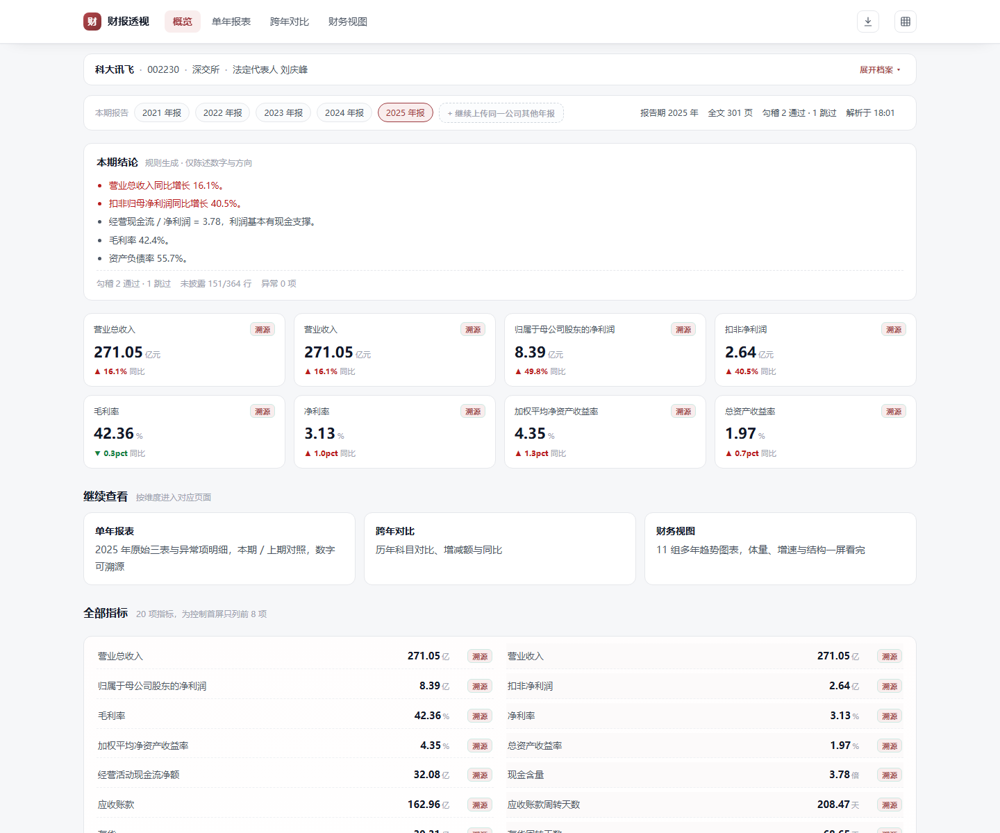
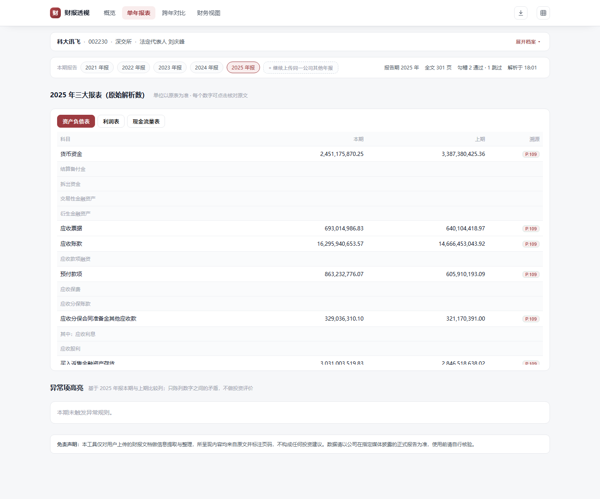
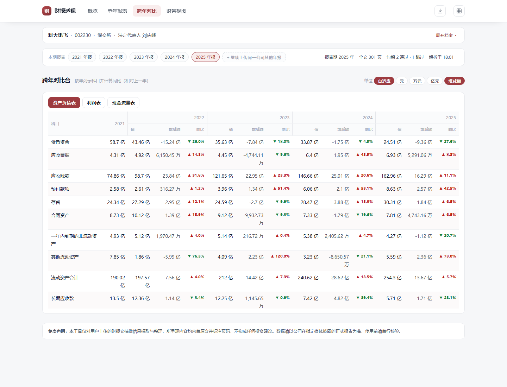
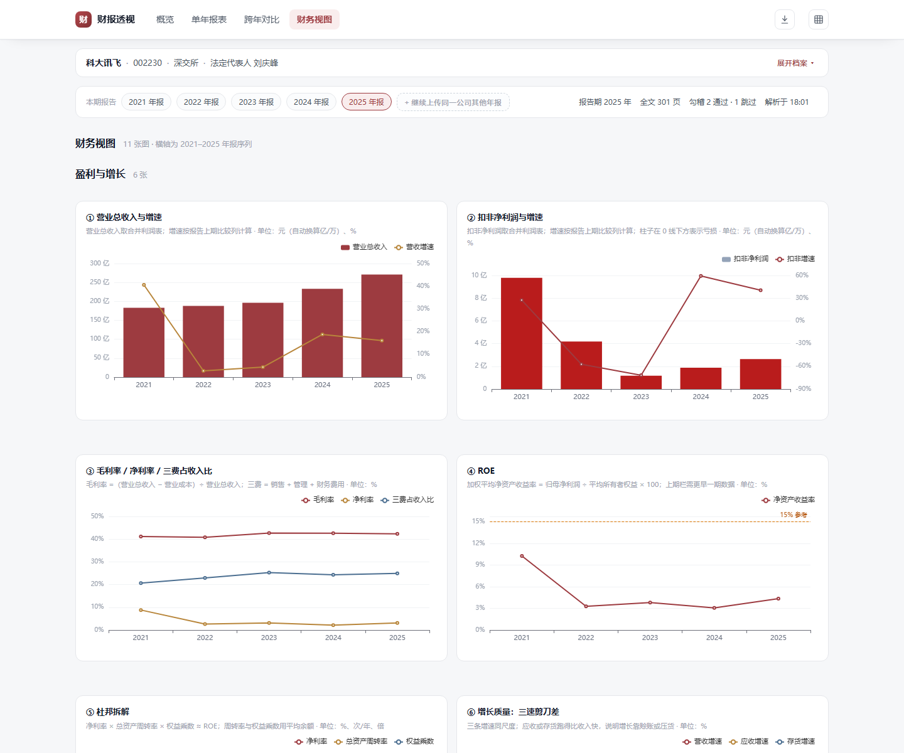

# moqian-fin-lens

> **Look at financial reports through a focused lens.**
> 财报透镜：剥离报表水分，透视企业真实盈利与现金流。

A 股财报解析工具，提取核心财务指标并可视化基本面。

上传 A 股年报 PDF，自动整理成**可核对**的财务视图：三表结构化、20 项核心指标、11 组多年趋势图、异常项提示，每个数字都能回到原文页码。

moqian-fin-lens parses A-share annual report PDFs into structured statements, 20 core metrics, 11 multi-year charts and anomaly hints — every number traceable to its source page.

[](LICENSE)


当前版本：v0.4.0（开源首发）

## 界面



| 单年报表：原始三表 + 页码溯源 | 跨年对比：单位切换、增减额、同比 |
| --- | --- |
|  |  |



> 截图来自科大讯飞（002230）2021–2025 年报的演示会话。

## 这是什么

年报动辄两三百页：三表跨页、科目写法五花八门、附注藏在几百页之后。通用 AI 直接给结论，却给不出出处；人工翻页核对，一份报告要花上半天。

moqian-fin-lens 做两件事：

1. **把「看不懂」变成「看得懂」**：三表结构化、20 项关键指标、11 组多年趋势图，回答「赚的钱是不是真的」这类问题；
2. **把「不敢信」变成「可核对」**：每个数字都带页码与原文片段，点开即见出处。

定位是**信息提取与整理**：只罗列财报里的数字与它们之间的关系，不做预测、估值或投资建议。

## 功能

| 能力 | 说明 |
| ---- | ---- |
| 三表结构化 | 合并资产负债表 / 利润表 / 现金流量表，保留原始数与单位，本期 / 上期对照 |
| 20 项核心指标 | 扣非净利润、经营现金流、ROE、毛利率、净利率、资产负债率、应收 / 存货周转、现金含量等；自由现金流在图表层衍生 |
| 11 组多年趋势图 | 盈利与增长 6 张、现金质量 2 张、风险与结构 3 张，横轴为会话内多年年报序列 |
| 跨年对比台 | 最多 5 期，单位自适应 / 元 / 万 / 亿切换，增减额与同比，分组表头 |
| 异常项高亮 | 规则化陈列数字之间的矛盾（应收增速远超营收、现金含量 < 1、有息负债快速上升等），中性措辞 |
| 原文溯源 | 每个数字可查看页码 + 原文片段，防止「自动抽取不可信」 |
| 导出 | Markdown 报告与 Excel 明细 |
| 多期会话 | 同一公司依次上传年报，自动对齐成时间序列；单期会话用报告比较列补齐 |

明确不做：涨跌预测、估值打分、荐股、自动抓取财报、交易、港股 / 美股；扫描件 OCR 在 v1.1 评估。

## 快速开始

### 本地运行

> 前置依赖：Python 3.11+

```bash
python -m venv .venv
.venv\Scripts\activate            # Windows；macOS / Linux 用 source .venv/bin/activate
pip install -e ".[dev]"           # 国内网络可加 -i https://pypi.tuna.tsinghua.edu.cn/simple
cp .env.example .env              # Windows PowerShell：Copy-Item .env.example .env
uvicorn app.main:app --reload     # 打开 http://127.0.0.1:8000
```

验证：

```bash
curl http://127.0.0.1:8000/healthz   # {"status":"ok"}
pytest --cov                          # 覆盖率门槛 80%
```

### Docker

```bash
docker compose up --build
docker compose exec app python -c "import urllib.request; print(urllib.request.urlopen('http://127.0.0.1:8000/healthz').read())"
```

## 使用流程

1. 上传一份或多份（同公司、≤ 5 期）年报 PDF；
2. 等待解析进度，完成后自动跳转概览；
3. 概览看结论与关键指标 → 单年报表核对原始数 → 跨年对比看变化 → 财务视图看多年趋势；
4. 点任意数字旁的「溯源」查看页码与原文片段；
5. 需要留档时导出 Markdown / Excel。

## 技术栈与架构

- **后端**：Python 3.11、FastAPI、Jinja2（服务端渲染，无 SPA）
- **解析**：pypdfium2（文本层）、pdfplumber（表格与坐标）、openpyxl（导出）
- **前端**：原生 JS + ECharts 5（本地打包，无 CDN 依赖）
- **存储**：SQLite（WAL），只存结构化结果与溯源片段，原件解析后即删除
- **质量**：238 项测试、覆盖率 90.55%；以文档驱动开发（PRD → 架构 / ADR → 接口契约 → 任务卡）

详细设计见 [`docs/architecture.md`](docs/architecture.md)、[`docs/prd.md`](docs/prd.md)、[`docs/api-contract.md`](docs/api-contract.md)。

## 项目结构

```text
moqian-fin-lens/
├── src/
│   ├── app/             # FastAPI 入口、模板、静态资源
│   ├── core/            # 配置、日志、错误码、响应体
│   ├── parse/           # 文本层、表格、三表定位、数值归一
│   ├── schema/          # 标准科目 Schema 与别名映射
│   ├── align/           # 科目对齐
│   ├── metrics/         # 指标、同比、三表勾稽
│   ├── anomaly/         # 异常规则与证据
│   ├── dashboard/       # 多年趋势图表装配
│   ├── traceability/    # 页码 / 原文片段查询
│   ├── export/          # Markdown / Excel
│   ├── jobs/            # 解析任务状态机
│   └── store/           # SQLite 访问层与迁移
├── docs/                # PRD、架构、接口契约、任务卡、截图
├── tests/               # unit、integration、eval（真实年报评测集）
├── Dockerfile
├── docker-compose.yml
└── .github/workflows/   # CI：Markdown、shell、pytest
```

## 开发流程

1. 文档先行：`docs/prd.md` → `docs/architecture.md`（含 ADR）→ `docs/api-contract.md`，逐份人工确认；
2. 任务卡：`docs/tasks/` 一任务一文件，增量拆解，确认后更新 [`docs/tasks/readme.md`](docs/tasks/readme.md) 索引；
3. 只开发「前置依赖全部 done」的任务，验收与评测通过才标记 done。

规范见 [`CONTRIBUTING.md`](CONTRIBUTING.md)，AI 协作约束见 [`AGENTS.md`](AGENTS.md)，版本记录见 [`CHANGELOG.md`](CHANGELOG.md)。

## 路线图

- **v1.0（进行中）**：单期 / 多期解析、三表、20 指标、11 图、溯源、导出
- **v1.1**：账号与额度、扫描件 OCR、坐标级溯源、图表与导出增强
- **v2.0**：待定（同业对比等，走 MAJOR 流程）

## 免责声明

本工具仅对用户上传的财报 PDF 做信息提取与整理，所有呈现内容均来自原文并标注页码，不构成任何投资建议。数据请以公司在指定媒体披露的正式报告为准，使用前请自行核验。

## License

[MIT](LICENSE) © 2026 Moqian
